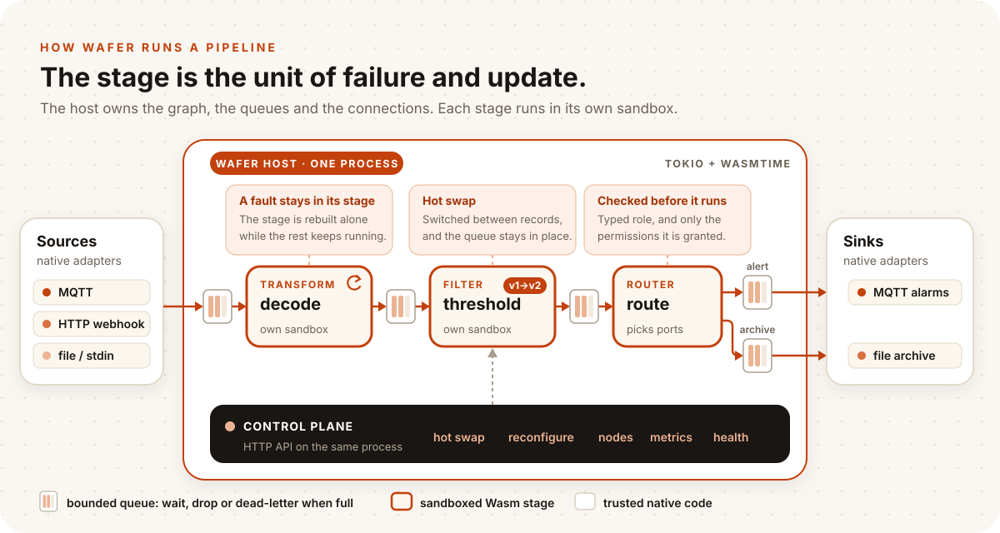

<p align="center">
  <picture>
    <source media="(prefers-color-scheme: dark)" srcset="brand/wafer-lockup-dark.svg">
    
  </picture>
</p>

<p align="center">
  An IoT gateway runtime where each pipeline stage is the unit of failure and update.
</p>

<p align="center">
  <a href="#try-it">Try it</a> ·
  <a href="docs/operations/getting-started.md">Tutorial</a> ·
  <a href="docs/architecture/00-vision.md">Architecture</a> ·
  <a href="docs/README.md">Documentation</a>
</p>

An IoT gateway runs a pipeline of short processing steps, called stages, that
decode, filter and route sensor readings between local equipment and the
cloud. Stages often come from different vendors and change after deployment.
WAFER keeps a fault in one stage from stopping the gateway, and lets an
operator replace one stage while the rest of the pipeline keeps running.

The runtime, called the host, owns everything that must outlive a stage: the
pipeline graph, the queue in front of each stage, and the connections to the
outside. Each stage is a WebAssembly component that runs in its own sandbox
inside the host process. The host can therefore rebuild a failed stage alone,
and swap a stage that keeps no state for a new version between two records,
without losing or duplicating any. We call that replacement a hot swap.

## What WAFER does

<p align="center">
  
</p>

| | |
| --- | --- |
| **Sandboxed stages** | Each stage has its own Wasmtime store and memory, and only the capabilities its configuration grants. Memory limits, and optional fuel and epoch limits, bound what a faulty stage can consume. |
| **Fault containment** | A stage that traps or returns an unrecoverable error is rebuilt from its compiled component while the other stages keep processing. The failed record goes to the dead-letter sink when one is configured. |
| **Hot swap** | A new version is compiled and initialized in the background, then adopted between two records. The stage's queue, limits and permissions stay in place; its in-memory state does not carry over. If the new version fails to start, the old one keeps running. |
| **Typed contracts** | One `wafer:pipeline` WIT package defines the Transform, Filter and Router roles and a capability-gated Inference world. The host checks every component against its role before it runs. |
| **Bounded queues** | Every stage reads from one bounded queue. When it is full, each incoming edge either makes the sender wait, drops the record, or sends it to a dead-letter sink, and the host counts each outcome. |
| **Native I/O** | Sources and sinks are trusted Rust adapters for MQTT, HTTP webhooks, files and standard input and output. |
| **One process** | A pipeline is one TOML file and one Linux process, with an HTTP control plane and Prometheus metrics. No Kubernetes and no container per stage. |

WAFER does not provide distributed execution, windows or joins, exactly-once
delivery, or migration of a stage's state between versions.

## Try it

You need [Rust through rustup](https://rustup.rs/) and a C toolchain. The
first build downloads crates and a pinned ONNX Runtime and takes several
minutes.

```bash
git clone https://github.com/ComputerNetworks-UFRGS/wafer.git
cd wafer
cargo build --locked -p wafer-runtime
plugins/build-plugins.sh uppercase json-parse
```

Start a pipeline that reads lines from standard input, passes them through the
`uppercase` stage and prints them. Type `hello` and press Enter:

```bash
cargo run -p wafer-runtime -- --config examples/dag-uppercase.toml
# hello
# HELLO
```

The pipeline is defined in [`examples/dag-uppercase.toml`](examples/dag-uppercase.toml):

```toml
[engine]
default_queue_capacity = 1024

[dead_letter]
kind = "file"
path = "dlq.jsonl"

[nodes.source]
type = "source"
kind = "stdin"

[nodes.uppercase]
type = "transform"
plugin = "../plugins/uppercase/target/wasm32-wasip2/release/wafer_uppercase.wasm"

[nodes.sink]
type = "sink"
kind = "stdout"

[[edges]]
from = "source"
to = "uppercase"

[[edges]]
from = "uppercase"
to = "sink"
```

While it runs, the control plane listens on `127.0.0.1:9090`. From a second
terminal, list the stages and hot swap `uppercase` for the `json-parse`
component:

```bash
curl -s http://127.0.0.1:9090/api/v1/nodes
curl -s -X POST http://127.0.0.1:9090/api/v1/nodes/uppercase/hot-swap \
  -H 'content-type: application/json' \
  -d '{"wasm_path":"./plugins/json-parse/target/wasm32-wasip2/release/wafer_json_parse.wasm"}'
```

Back in the first terminal, type `{"temp": 21}`. The same stage now
pretty-prints JSON, and the pipeline never stopped. The
[tutorial](docs/operations/getting-started.md) walks through these steps in
more detail, and [`examples/`](examples/) has more pipelines, with MQTT, HTTP,
fan-out, dead-letter handling, metrics, components pulled from an OCI
registry, and an ONNX inference stage.

## Documentation

| If you want to | Read |
| --- | --- |
| Run a first pipeline | [Getting started](docs/operations/getting-started.md) |
| Understand the design | [Architecture](docs/architecture/00-vision.md), [ADRs](docs/adr/) and [RFCs](docs/rfcs/) |
| Configure a pipeline | [Configuration](docs/operations/configuration.md) and the [schema reference](docs/interfaces/config-schema.md) |
| Write a stage | [WIT contracts](docs/interfaces/wit-contracts.md) and the [plugin SDK](docs/interfaces/plugin-sdk.md) |
| Operate a running pipeline | [HTTP API](docs/interfaces/http-api.md) and [observability](docs/operations/observability.md) |
| Learn the code | [Source-guided learning path](docs/learn/README.md) |
| See what is implemented | [Implementation status](docs/status/implementation-status.md) |

## Repository map

| Path | Contents |
| --- | --- |
| [`crates/`](crates/) | Host runtime, core engine, configuration, shared types, `waferctl`, load generator and guest SDK. |
| [`wit/`](wit/) | The `wafer:pipeline` WIT package and pinned dependency interfaces. |
| [`plugins/`](plugins/) | Example stages in Rust, fault-injection components, and Go and Python demonstrations. |
| [`examples/`](examples/) | Runnable pipeline configurations. |
| [`docs/`](docs/) | Architecture, interfaces, operations guides, design records and the learning path. |
| [`eval/`](eval/) | Experiment definitions and the evaluation harness. |

## Development

```bash
mise trust && mise run setup
mise run fmt
mise run clippy
mise run test
```

[mise](https://mise.jdx.dev/) installs the helper tools and runs the tasks;
`mise tasks ls --all` lists them. Rust is pinned in
[`rust-toolchain.toml`](rust-toolchain.toml). See
[CONTRIBUTING.md](CONTRIBUTING.md) before opening a pull request.

## Research

WAFER was built for an undergraduate thesis at the Federal University of Rio
Grande do Sul (UFRGS), which evaluated it on a Raspberry Pi 5, a Jetson Orin
Nano and an x86 laptop against a native build and the eKuiper stream
processor. The evaluation data is archived at
[doi:10.5281/zenodo.24043514](https://doi.org/10.5281/zenodo.24043514). See
[`CITATION.cff`](CITATION.cff) for how to cite the work.

WAFER is a research prototype and is not hardened for production use.

## License

WAFER is available under the [MIT License](LICENSE).
