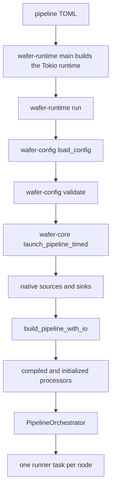

# Configuration to running pipeline

> **Read first:** [Workspace and ownership map](workspace-map.md) and [Tokio in WAFER's context](tokio-in-context.md).

This walkthrough follows one pipeline file from `wafer --config <path>` to the Tokio tasks that run its nodes. By the end you will be able to name the function that owns each step (runtime construction, parsing, validation, the structural graph check, queue creation, plugin loading, and task spawning), explain why configuration is validated twice, and explain why no topological order decides when a task starts.

## The call path



### 1. Build the runtime and load the file

`main` in `crates/wafer-runtime/src/main.rs` builds a multi-thread Tokio runtime by hand and runs the async `run` function on it with `block_on`. Building it by hand, instead of using `#[tokio::main]`, lets `main` record the process-entry time with `startup::ProcessEntry::capture` before Tokio exists. When `run` returns a startup error, `main` maps it to exit code 1 or 2 through `startup_exit_code`.

`run` parses `--config` and calls `wafer_config::load_config` (`crates/wafer-config/src/loader.rs`), which only reads and deserializes:

```rust
pub fn load_config(path: &Path) -> Result<Config, ConfigError> {
    let content = std::fs::read_to_string(path)?;
    let config: Config = toml::from_str(&content)?;
    Ok(config)
}
```

A file can deserialize into a `Config` and still contain unknown edge endpoints, an orphan node, a cycle, or an invalid source or sink direction. Those are semantic errors, checked next.

### 2. Collect every validation error

`run` then calls `wafer_config::validate(&config)` (`crates/wafer-config/src/validation.rs`). The validator runs all of its checks into one `Vec<ValidationError>` and returns them together, so an operator sees every mistake at once. Its cycle check is `check_no_cycles`. The runtime joins the errors into one `anyhow` error, marked as an invalid configuration (exit code 2), before any engine, adapter, queue, or task exists.

The test `every_eval_config_loads_and_validates` (`crates/wafer-config/tests/eval_configs_load.rs`) runs both functions over every `eval/configs/**/*.toml` except comparator configs.

### 3. Enter the core launcher

`run` then passes a clone of the configuration to `launch_pipeline_timed` (`crates/wafer-core/src/orchestrator/launcher.rs`). The launcher:

1. creates the Wasmtime engine with `WaferEngine::for_pipeline`, starts its epoch-ticker thread (`ensure_epoch_ticker`), and creates the plugin registry;
2. creates the native source and sink trait objects with `create_source` and `create_sink`, each of which runs the adapter's `validate()`; a failure there is also a configuration error with exit code 2;
3. calls `build_pipeline_with_io` to build the topology and control state;
4. resolves, compiles, instantiates, validates, and initializes each Wasm processing plugin (`load_transform_node`, `load_filter_node`, `load_router_node`; see [Cross the plugin boundary](plugin-boundary.md)), and builds native Transform and Filter baselines directly;
5. puts those processing nodes into their bundles and records which loaded Wasm nodes may be hot-swapped (`mark_replacement_eligible`);
6. hands the finished `BuildOutput` to `PipelineOrchestrator::from_build_output`.

The builder does not compile plugins. That split lets tests supply `ChannelSource` and `ChannelSink` and still exercise the production queue wiring.

### 4. Check the graph and wire queues

`build_pipeline_inner` (`crates/wafer-core/src/orchestrator/builder.rs`) first calls `DagGraph::from_config` from `crates/wafer-core/src/dag/graph.rs`, which again rejects an empty graph, unknown endpoints, and cycles. `validate_channel_capacities` then rejects a queue capacity of zero, which would make Tokio panic.

The graph is only a check. The builder stores it in `BuildOutput::dag_graph`, but nothing reads that field and nothing calls `topo_order`. Bundles are built, and tasks later spawned, in the iteration order of `config.nodes`, which is a `HashMap`. The separate `wafer_config::DagGraph` (`crates/wafer-config/src/dag.rs`) is not on this path at all: only its own tests call it.

`wire_queues` groups edges by destination and creates one bounded channel per destination node. Every inbound edge gets a clone of that node's sender, which is how fan-in works: several producers, one receiver. The capacity is the largest one any inbound edge declares, or the engine default:

```rust
let capacity =
    edges_to_dest.iter().filter_map(|e| e.capacity).max().unwrap_or(default_capacity);
```

For every node, the builder then moves its receiver, downstream senders, child cancellation token, state tracker, metrics, and an empty implementation slot into a `NodeBundle`. Processing bundles also get a watch channel for hot-swap and an `ErrorPolicyExecutor`.

### 5. Move bundles into tasks

`PipelineOrchestrator::from_build_output` (`crates/wafer-core/src/orchestrator/pipeline.rs`) keeps the shared cancellation token, control handles, metrics, and configuration, and creates the `JoinSet`. It spawns the optional DLQ writer, then calls `spawn_bundles`.

`spawn_bundles` consumes every bundle, moving each into one `async move` task. Source and sink tasks run their adapter's `init()` before entering their loops, and an `init()` failure cancels the whole pipeline (`fail_io_init`). Transform, Filter, and Router bundles enter their processing loops. So the value `launch_pipeline_timed` returns is already running, which is why `run` can log the task count right after `into_parts`.

## Why validate twice?

`wafer_config::validate` gives operators complete, accumulated diagnostics. The core `DagGraph` check protects `wafer-core` when some other caller, such as a test or an embedding program, builds a pipeline from a `Config` that never went through `validate`. In production `wafer-core` does not depend on `wafer-config`; its manifest lists it only under development dependencies.

## A limit to keep in mind

A Router with `plugin.kind = "native"` passes `validate`, and the doc comment on the native plugin functions in `crates/wafer-types/src/config/mod.rs` lists a native `content-router`, but `load_router_node` always resolves a Wasm component, so launch fails.

## Check yourself

Starting at `main`, name the function that owns each transition: runtime construction, TOML to `Config`, semantic checks, the structural graph check, queue creation, plugin loading, and bundle-to-task movement. Then explain why `wafer_config::DagGraph` is not on this call path, and what decides the order in which tasks start.

## Next

[Follow one message through Wasm](message-through-wasm.md) picks up once the tasks are running.
