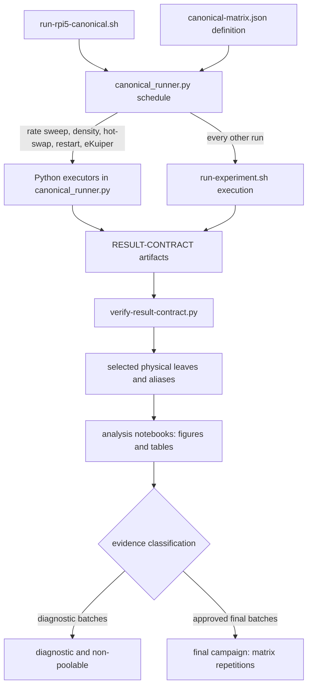

# From experiment definition to evidence

> **Read first:** [Workspace and ownership map](workspace-map.md). Basic JSON and Python reading helps; `eval/RESULT-CONTRACT.md` defines the terms.

This walkthrough follows an evaluation claim from its machine-readable definition, through the scripts that run it and the checks that accept its output, to the analysis notebooks and the evidence class that decides whether it may appear in the thesis. By the end you will know which file defines an experiment, which code runs it, which Rust code writes each result file, how a result directory is verified, and why counting messages or events never increases the number of independent runs. You can follow it with paths, schemas, and tests alone; no result values are needed.

## The path

1. `eval/canonical-matrix.json` defines experiment IDs, condition grids, repetitions, sample units, required outputs, ordering, metering, evidence class, and admission flags. Each experiment in the `enhanced_candidate` block is N=5 candidate or diagnostic work and sets `thesis_evidence=false` and `n30_admitted=false`.
2. `eval/scripts/run-rpi5-canonical.sh` runs `eval/scripts/lib/canonical_runner.py` (`main`), which turns definitions into deterministic `RunItem` schedules (`build_schedule`). `run_attempt` picks the execution path. Rate sweeps (`e-perf-10` and the capacity runs), `e-density-1`, the hot-swap runs (`e-swap-1`, `e-swap-4`, `e-swap-5` and the session experiments), `e-swap-3` restarts, and eKuiper runs go to Python executors in the same file, which start their own processes. Every other run calls `run-experiment.sh`. The runner writes progress and summaries, post-processes outputs, and calls `verify_result` for each physical leaf.
3. `eval/scripts/run-experiment.sh` handles one run: configuration, runtime and load-generator processes, bounded collection, shutdown, metadata, and result placement. It writes to the exact `--output-dir` the runner passes, or delegates fresh local result-directory creation to `eval/scripts/collect-results.sh`, which creates `eval/results/<experiment>/<host>-<UTC timestamp>/` and never overwrites an existing directory.
4. `eval/RESULT-CONTRACT.md` assigns each artifact to its producer and states which experiments require it. `eval/scripts/verify-result-contract.py` and experiment-specific checks reject missing, malformed, inconsistent, or wrongly classified evidence.
5. Shared experiment IDs are aliases to one selected physical leaf. An alias receipt preserves identity; it does not copy evidence or create another replicate.
6. The notebooks under `eval/analysis/notebooks/` resolve their input through `wafer_analysis.paths.resolve_analysis_batch`: an explicit diagnostic path, or the approved batch named by `WAFER_EVAL_BATCH_ID`. The cross-architecture notebook, `04-cross-arch.ipynb`, uses `resolve_host_batches` instead and resolves one batch per host. The notebooks render figures and tables that carry run counts, units, estimator, and evidence class.

## Which code writes which file

When a run starts the runtime, the harness sets `WAFER_BENCH_OUTPUT_DIR` to the result directory, and the runtime writes its artifacts there. The "Ownership summary" in `eval/RESULT-CONTRACT.md` maps every file to its producer. The Rust producers are:

- `BenchSink::export_to_dir` (`crates/wafer-core/src/node/sink/bench.rs`) writes the in-process `latency.hdr` and `throughput.csv` when the sink closes, plus `service.hdr` and `source-lag.hdr` when messages carried bench stamps, and `sequence.csv` and `swap_timeline.json` when enabled. `BenchSource` (`crates/wafer-core/src/node/source/bench.rs`) generates load inside the runtime.
- `flush_bench_artifacts` in `crates/wafer-runtime/src/main.rs` writes `memory.csv`, and `queue-depth.csv` to the path in `WAFER_QUEUE_DEPTH_OUTPUT` when that is set, from the samplers in `crates/wafer-core/src/bench/`, then `per_node_metrics.csv` and `recovery.csv` through `PipelineOrchestrator::export_per_node_metrics` (`crates/wafer-core/src/orchestrator/pipeline.rs`).
- `crates/wafer-runtime/src/metadata.rs` (`write_provenance`) writes `runtime-provenance.json`, which the harness merges into `metadata.json`. `crates/wafer-runtime/src/startup.rs` (`write_startup`) writes the startup-phase file named by `WAFER_STARTUP_OUTPUT` (`startup.json`).
- `LatencyRecorder::write_artifacts` (`crates/wafer-loadgen/src/recorder.rs`) writes the end-to-end `latency.hdr`, `sequence.csv`, and `subscriber-metadata.json` for `wafer-loadgen subscribe`.

The controller and analysis are Python. `RunItem` is a frozen dataclass carrying one physical run identity. `ResultsLayout` (`eval/analysis/src/wafer_analysis/results_layout.py`) confines raw, manifest, derived, and report paths: under `eval/` by default, or under a mounted `WAFER_RESULTS_ROOT`. Analysis reads selected raw files and writes outside the raw tree.

Counts need type-like discipline even though Python tables are dynamic. A complete host run is an independent sample. Messages, aliases, events, buckets, and one-second intervals are nested observations or alternate views. More rows improve within-run detail; they do not increase independent N.

## Evidence classes

Evidence classification is part of the data contract, not a caption added later. The completed expanded N=5 rehearsal is diagnostic, descriptive, and non-poolable with final or earlier campaigns. Its records remain `thesis_evidence=false` and outside N=30 admission.

The final batches for the canonical Raspberry Pi 5 and the Jetson and x86 replication hosts are approved in `eval/final-batches.json`. Each experiment uses the repetitions set in `eval/canonical-matrix.json`, 30 for most. Diagnostic batches support descriptive patterns only. PMIC readings remain an internal-rail proxy, not total input power.

Capacity classification is support-aware. When the MQTT loopback support cell is delivery-bad, affected SUT cells at that rate and above are support-confounded. These cells set neither bound of a delivery ceiling, even if a SUT leaf contains measurements. A nested interval, bucket, message, or event cannot remove that censoring.

Do not quote old desktop or Raspberry Pi 4 shakedown values as current or final evidence. Historical layouts remain readable for provenance, not promotion.

## Limits to keep in mind

- A matrix entry with `thesis_evidence=true` describes the frozen final design; it does not by itself prove that a run happened or was admitted. Read it together with `eval/final-batches.json`.
- E-Perf-5 still declares `claim_status: pending-until-x86` although the matched x86 batch is approved. The field stays because changing the matrix would change the hash the approved batches are bound to.

## Check yourself

**1. Which file defines an experiment, and which file says which result batches are final?**

Answer

`eval/canonical-matrix.json` defines each experiment. `eval/final-batches.json` lists the approved final batches; a matrix entry alone does not prove a run happened or was admitted.

**2. Five runs each record fifty swap events. What is N?**

Answer

N=5. A complete host run is the independent sample; events, messages, aliases, and intervals are nested observations inside it.

## Next

For operator steps, see the [evaluation runbook](../eval/experiment-runbook.md). To revisit any runtime behavior a result depends on, return to the [first-read order](README.md#first-read-order).
