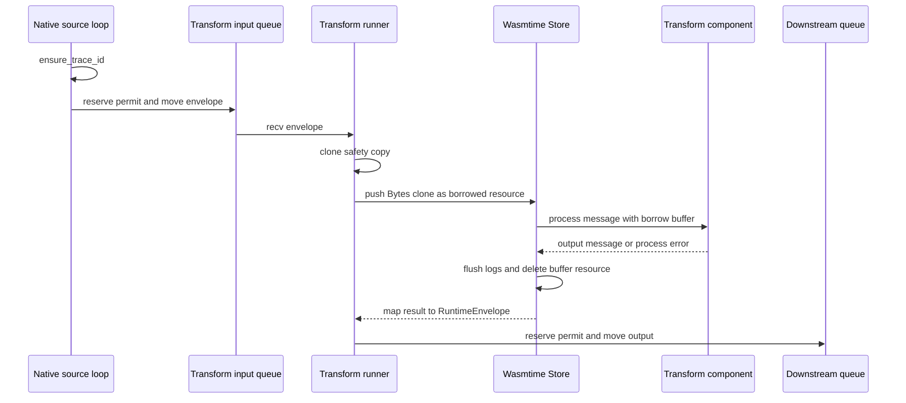

# Follow one message through Wasm

> **Read first:** [Configuration to running pipeline](config-to-running-pipeline.md). The terms [ownership](rust-in-context.md#ownership), [move](rust-in-context.md#move), [Arc](rust-in-context.md#arc), and [RAII](rust-in-context.md#raii) are used throughout.

This walkthrough follows one `RuntimeEnvelope` from a native source, through a transform component, to the next bounded queue. By the end you will be able to point to each ownership move, each deliberate clone, the exact places where payload bytes are copied, and the reason cancellation can stop a node only between messages. It also shows where "zero-copy" stops being true.

## The path



### 1. The source creates the envelope

A native source adapter returns a `RuntimeEnvelope` (`crates/wafer-core/src/queue/envelope.rs`):

```rust
#[derive(Debug, Clone)]
pub struct RuntimeEnvelope {
    pub header: Arc<EnvelopeHeader>,
    pub payload: Bytes,
    pub(crate) lineage: Lineage,
    /// ...
    pub retry_count: u32,
}
```

The header (id, timestamp, source, content type, metadata, and host-only benchmark stamps) is immutable and shared through `Arc`; the payload is a reference-counted `Bytes`. `lineage` holds the parent and trace ids. `run_source_loop` (`crates/wafer-core/src/runner/source.rs`) calls `envelope.ensure_trace_id()` and then `send_downstream`.

With one destination the envelope is moved. With several, `send_matching` (`crates/wafer-core/src/runner/mod.rs`) clones it for all but the last sender. A clone bumps the `Arc` and `Bytes` reference counts instead of copying the header or payload; only the two short lineage strings are copied. The envelope's clone tests check that both backing stores are shared.

### 2. The edge policy decides how to send

Every send goes through `send_one`, which reads the edge's overflow policy from `DownstreamSender`. A `slow` edge waits for space; `drop` and `dead-letter` edges never wait. [Tokio in context](tokio-in-context.md#bounded-mpsc-between-nodes) shows the calls behind each policy.

### 3. The runner receives outside the guest

At the top of each iteration, `run_transform_loop_with_config` (`crates/wafer-core/src/runner/transform.rs`) first applies a pending swap if there is one. Otherwise `next_input` returns a held envelope or calls `recv_next_or_retry`, which returns a ready retry or waits in a `select!` for cancellation, a message, a swap, or the next retry deadline.

Once a message arrives, the runner keeps a cheap `safety` clone for retry or dead-lettering, then calls the guest as a plain statement, outside any `select!`:

```rust
let result = transform.process(envelope).await;
```

Here `transform` is the runner's `TransformNode` enum (`crates/wafer-core/src/node/mod.rs`); its `Wasm` variant forwards to `WasmTransformNode::process` (`crates/wafer-core/src/node/wasm.rs`). Because the call is not a `select!` branch, cancellation can never drop it halfway and leave the `Store` mid-call. Cancellation is seen at the next receive.

### 4. The host builds the WIT input and calls the guest

The node and its own `Store` were built by `load_transform_node` (`crates/wafer-core/src/orchestrator/launcher.rs`). `WasmTransformNode::process` clears the log buffer, resets fuel and the epoch deadline, and then:

```rust
let wit_msg = build_wit_message(&mut self.store, &envelope)?;
```

`build_wit_message` puts a `Bytes` clone into the Store's resource table (`push_buffer` in `crates/wafer-core/src/engine/state.rs`), copies the header strings and metadata into the generated WIT `Message`, and passes the payload as a borrowed handle. In `wit/pipeline-types.wit` the field is declared `payload: borrow<buffer>`, so a guest that never reads the payload never causes it to be copied.

When the guest does call `read` or `read-all`, the call lands in the `HostBuffer` impl on `WaferState` (`crates/wafer-core/src/engine/bindings.rs`), which calls `WaferBuffer::read` or `read_all` (`crates/wafer-core/src/engine/buffer.rs`). Those copy the bytes into a new `Vec<u8>`, and Wasmtime copies that list into guest memory.

After `call_process` returns, `process` flushes the guest's logs and deletes the buffer resource, even when the call trapped. If that cleanup fails after a successful call, the result becomes `WasmProcessError::Trapped` without a trap code; after a trap, the trap's own code is kept. [Wasmtime in context](wasmtime-in-context.md#resource-handles) explains why the delete is needed.

### 5. The guest result becomes a new envelope

The transform interface returns either an `output-message` or one of five `process-error` variants. On success, `RuntimeEnvelope::from_guest_output` (`crates/wafer-core/src/queue/envelope.rs`) builds a new envelope from the guest's id, timestamp, source, content type, metadata, and payload. Lineage and benchmark stamps come from the input, and `retry_count` starts again at zero because retries are budgeted per node. Guest timestamps stay message data; they never replace the host's benchmark clocks.

The output payload is a WIT `list<u8>`, not a resource, so Wasmtime copies it out of guest memory into a host `Vec<u8>`, which becomes the new envelope's `Bytes`. So the boundary is zero-copy only for input the guest does not read: header strings, metadata, read payload bytes, and Transform output are all copied.

### 6. The output goes to the next queue

On success the runner counts the message (`NodeMetrics::record_processed` in `crates/wafer-core/src/node/metrics.rs`) and calls `send_downstream`. If a hot-swap is waiting for its first outcome, or a canary window is open, the runner records that too. On a guest error or trap, the `safety` clone feeds retry, dead-lettering, timeout recovery, or rollback, which [Shutdown and failure behavior](shutdown-and-failure.md) covers.

## What the code does not promise

- Fan-in has no fairness or ordering guarantee: several producers share one queue.
- The node owns one Store and permits one guest call at a time. The async bindings let a guest's host call, such as an outbound HTTP request, yield to Tokio without blocking a worker; they do not make the guest concurrently callable.

## Check yourself

**1. When the source fans an envelope out to two destinations, what does the clone copy?**

<details markdown="1">
<summary>Answer</summary>

Only the two short lineage strings. The header is behind an `Arc` and the payload is `Bytes`, so cloning bumps their reference counts instead of copying them.

</details>

**2. Where are payload bytes copied on their way into and out of a transform?**

<details markdown="1">
<summary>Answer</summary>

Into the guest only if it reads the payload: `WaferBuffer::read` or `read_all` copies into a `Vec<u8>`, and Wasmtime copies that list into guest memory. The output `list<u8>` is always copied out of guest memory into a host `Vec<u8>`.

</details>

**3. Why can cancellation stop a transform node only between messages?**

<details markdown="1">
<summary>Answer</summary>

The runner waits for input inside a `select!` that includes cancellation, but it awaits the guest call as a plain statement. A running call always completes, and cancellation is seen at the next receive.

</details>

## Next

[Wasmtime in WAFER's context](wasmtime-in-context.md) explains the Engine, Store, bindings, and limits behind step 4.
