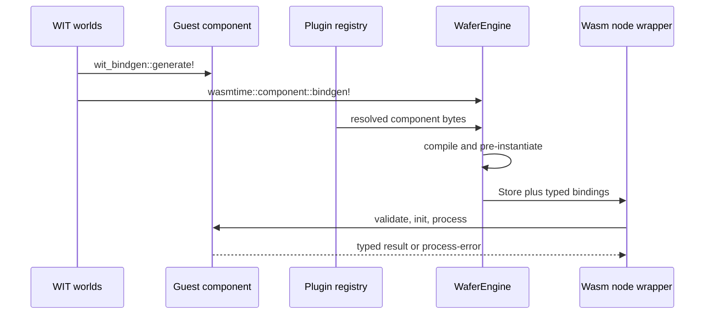

# Cross the plugin boundary

> **Read first:** [Wasmtime in WAFER's context](wasmtime-in-context.md).

This walkthrough follows one processing plugin from its WIT world, through the guest and host code generated from that world, to a live instance that the runner calls. By the end you will be able to take `plugins/pass-through/src/lib.rs` and name the generated guest trait it implements, the host binding that calls it, the launcher function that builds its Store, and the place where the host cleans up after each call. You will also see why a source or sink needs a native adapter rather than a new WIT world.

Keep the [WIT contracts](../interfaces/wit-contracts.md) and the [plugin SDK](../interfaces/plugin-sdk.md) open for exact signatures and macros; this page does not repeat them.

## The path



### 1. The world is the contract

`wit/worlds.wit` defines four guest worlds: `transform-node`, `filter-node`, `router-node`, and `inference-node`. Transform, Filter, and Router are the three processing roles; `inference-node` is a Transform that may also import the pinned `wasi:nn` interfaces. There is no source or sink world: sources and sinks are native Rust adapters created by `create_source` and `create_sink` in `crates/wafer-core/src/orchestrator/launcher.rs`, because the WIT describes processing, not transport protocols.

### 2. The guest implements the generated traits

A plugin picks one world with `wit_bindgen::generate!`, implements the generated `Guest` traits, and registers itself with `export!`. `plugins/pass-through/src/lib.rs` is the smallest complete example:

```rust
wit_bindgen::generate!({
    path: "../../wit",
    world: "transform-node",
    generate_all,
});
```

It implements `exports::wafer::pipeline::lifecycle::Guest` (`validate`, `init`, `close`) and `exports::wafer::pipeline::transform::Guest`, whose `process` reads the payload and returns it unchanged:

```rust
let payload = input.payload.read_all();
```

Other first-party plugins read their payload the same way: the threshold filter through the `wafer_plugin::payload_as_str!` macro, the content router with `read_all()` directly, and `plugins/mnist-inference/src/lib.rs` through `payload_bytes!` before calling wasi-nn. Each plugin is its own Cargo package built for `wasm32-wasip2`; see [Build, run, and test](workspace-map.md#build-run-and-test).

### 3. The host generates the matching calls

On the host side, `crates/wafer-core/src/engine/bindings.rs` runs `wasmtime::component::bindgen!` once per world. Where the guest got a trait to implement, the host gets a handle to call: the generated `TransformNode` has `wafer_pipeline_transform().call_process(...)` and `wafer_pipeline_lifecycle().call_validate(...)`. [Wasmtime in context](wasmtime-in-context.md#generated-bindings-with-bindgen) lists what the macro generates.

### 4. The registry finds the bytes, the engine compiles them

For each Wasm processing node, `resolve_and_load_component` (`crates/wafer-core/src/orchestrator/launcher.rs`) asks `WaferRegistry::resolve` (`crates/wafer-core/src/registry/client.rs`) for the component, from a local path or an OCI reference. `resolve` reads the bytes and computes their SHA-256, which is recorded as the node's plugin hash. The launcher then calls `WaferEngine::compile_cached`, so identical bytes are compiled once per pipeline.

The node's TOML `type`, and for a Transform its `allow_inference` grant, decide which world the host links against; the component itself never chooses. [Wasmtime in context](wasmtime-in-context.md#components-and-wit-worlds) traces that choice.

### 5. The launcher builds a Store and initializes the guest

`load_transform_node`, `load_filter_node`, or `load_router_node` creates a fresh `Store<WaferState>`, installs the memory limiter and any fuel or epoch limit, instantiates the component, and calls `validate_and_init`, which calls the guest's `validate` and then `init`. Only a Wasm Transform with `allow_inference = true` gets wasi-nn, and only exact configured destinations get outbound HTTP. The node wrapper then owns the Store, the bindings, and the cached pre-instance, and the runner task owns the wrapper.

### 6. Each call crosses the boundary once

For every message, `WasmTransformNode::process`, `WasmFilterNode::evaluate`, or `WasmRouterNode::route` in `crates/wafer-core/src/node/wasm.rs` builds the WIT message with a borrowed buffer handle, awaits the generated call, flushes the guest's logs, deletes the buffer, and maps the result or trap into the host error model. [Follow one message through Wasm](message-through-wasm.md) walks this for a transform.

## Testing a plugin without a pipeline

`PluginTestHarness` (`crates/wafer-core/src/testing/harness.rs`, behind the `test-support` feature) loads a built `.wasm` and calls its `process` without channels or an orchestrator. Tests that exercise the capability grants with real components include `inference_recovery_and_reconfigure_keep_real_model_live` and `inference_and_outbound_http_survive_recovery_together` in `crates/wafer-core/src/node/wasm.rs`, `crates/wafer-core/tests/inference_lifecycle.rs`, and `crates/wafer-runtime/tests/mnist_inference.rs`. The real-component tests in `crates/wafer-core/tests/wasi_http_capability.rs` are `#[ignore]`; `mise run test-http-security` builds their fixture and runs them.

## Check yourself

**1. In `plugins/pass-through/src/lib.rs`, which generated trait does the guest implement for processing, and which host call invokes it?**

<details markdown="1">
<summary>Answer</summary>

The guest implements `exports::wafer::pipeline::transform::Guest` and its `process`. The host calls it through the generated `TransformNode` as `wafer_pipeline_transform().call_process(...)`.

</details>

**2. Which function builds the Store for a Wasm Transform and runs the guest's `validate` and `init`?**

<details markdown="1">
<summary>Answer</summary>

`load_transform_node` in `crates/wafer-core/src/orchestrator/launcher.rs` creates the `Store<WaferState>`, instantiates the component, and calls `validate_and_init`.

</details>

**3. Why does a new kind of source need a native adapter rather than a new WIT world?**

<details markdown="1">
<summary>Answer</summary>

The WIT worlds describe processing, not transport. There is no source or sink world; sources and sinks are native Rust adapters created by `create_source` and `create_sink`.

</details>

## Next

[Shutdown and failure behavior](shutdown-and-failure.md) covers what happens when a guest call fails or the pipeline stops.
