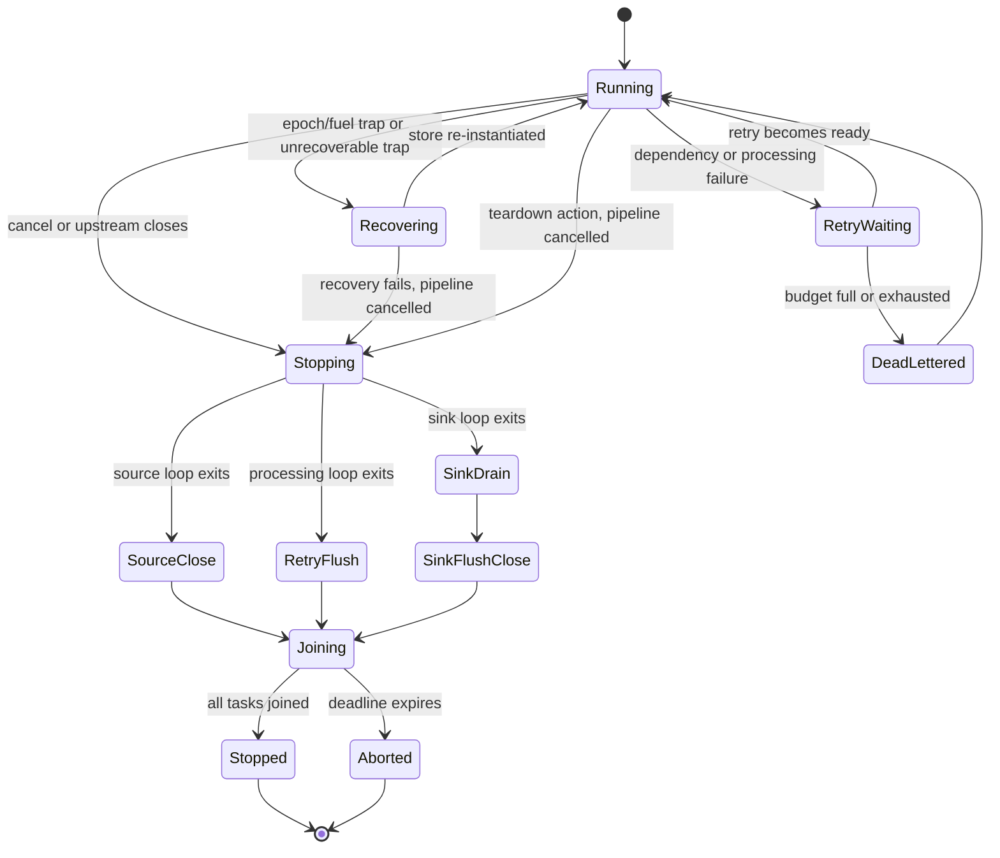

# Shutdown and failure behavior

> **Read first:** [Follow one message through Wasm](message-through-wasm.md) and [Tokio in WAFER's context](tokio-in-context.md).

This page explains what the runners do when input ends, cancellation arrives, a guest returns an error, a Wasm call traps, or tasks outlive the shutdown deadline. By the end you will be able to tell apart three ways a run ends (natural channel closure, cooperative cancellation, and a deadline abort), say what each kind of node cleans up, and follow a typed guest error to a retry, a dead-letter entry, a Store recovery, or a pipeline-wide stop. These paths share one cancellation token, but they do not form a single ordered shutdown algorithm.

## The states a node can pass through



The diagram combines several node-local paths. It does not imply that every task visits every state or that cleanup occurs in the displayed vertical order.

### Natural completion

A finite source exits when `poll()` returns `Ok(None)`. `run_source_loop` (`crates/wafer-core/src/runner/source.rs`) then calls `source.close().await`. Returning from the source task drops its downstream senders. A transform or sink whose last sender disappears receives `None` and leaves its loop. A processing runner that still holds retries in backoff gives them their attempt first (`recv_next_or_retry` in `crates/wafer-core/src/runner/mod.rs`). This channel-close cascade lets `run_until_complete` (`crates/wafer-core/src/orchestrator/pipeline.rs`) finish when its `JoinSet` becomes empty.

### External cancellation

The runtime's signal thread (`spawn_shutdown_signal_thread` in `crates/wafer-runtime/src/main.rs`) and the control-plane `shutdown` handler (`crates/wafer-core/src/api/handlers.rs`) both cancel the orchestrator's shared `CancellationToken`. Every node bundle owns a child token, created in `build_pipeline_inner` (`crates/wafer-core/src/orchestrator/builder.rs`). Source, transform, and sink loops use biased `tokio::select!` branches while awaiting their native poll or queue receive operation.

A processing node that is already inside a guest call finishes that call first, because the call is not a `select!` branch ([Tokio in context](tokio-in-context.md#select-and-cancel-safety) explains why). It sees cancellation at its next receive.

The orchestrator joins whichever task completes next until the deadline; it does not shut nodes down in reverse topological order. Both `shutdown` and the cancellation branch of `run_until_complete` use this bounded join pattern. If the deadline expires, `abort_stuck_tasks` calls `self.tasks.shutdown().await`, which aborts the tasks still held by the `JoinSet`.

### Node-local cleanup

Cleanup differs by runner:

- The source loop calls `source.close().await` after cancellation, EOF, or its exit path.
- Transform, filter, and router loops call `policy.flush_to_dlq(&DlqReason::Shutdown, &metrics)` whenever their loop exits, moving buffered retries to the DLQ path when a sender is available.
- The sink loop (`run_sink_loop` in `crates/wafer-core/src/runner/sink.rs`) exits its receive phase, uses `receiver.try_recv()` to consume messages already buffered, then calls `sink.flush().await` and `sink.close().await` even if collection during the drain reported an error.
- The DLQ task (`run_dlq_sink` in `crates/wafer-core/src/orchestrator/pipeline.rs`) takes no cancellation token. It keeps writing until every DLQ sender is dropped, which happens only after every node holding one has exited, so the retries that nodes flush on their way out still reach it. `run_until_complete` waits up to 5 s for it after the node tasks are joined.

A sink drains envelopes already buffered in its receiver, but the bounded orchestrator deadline means shutdown does not guarantee that every in-flight message completes. A message still executing in another node, waiting for queue capacity, or held in an aborted task can remain unfinished when the deadline expires.

### Guest errors and traps

WIT defines five process-error categories. `ErrorPolicyExecutor::handle` (`crates/wafer-core/src/runner/error_policy.rs`) decides the first four. The runners catch `unrecoverable` and traps other than epoch or fuel timeouts before they call `handle`:

| Category | Current behavior |
|---|---|
| `bad-input` | Apply the configured simple action: skip, DLQ, or teardown. |
| `dependency-failed` | Add to the bounded retry buffer with exponential backoff capped at 30 s (`MAX_BACKOFF_MS`), or apply its configured exhausted action. A full buffer sends the message to the DLQ as `RetryBufferFull`. |
| `processing-failed` | Use the same bounded retry and terminal-action path. |
| `timed-out` | Apply the configured `timed_out` simple action. |
| `unrecoverable` | The runner matches it before `handle` and recovers the instance, as described below. `handle` itself would return `Teardown`. |

The runners give ready retries priority over fresh messages and wake at the earliest due deadline even when upstream is idle. Retry count survives requeue. Once exhausted, `skip`, `dlq`, or `teardown` is honored; DLQ-full and DLQ-closed remain distinct outcomes and the envelope is not requeued. Transform preserves a safety clone before calling Wasm. Pending retries are flushed to the DLQ with a reason that says why: `HotSwapDrain` after a replacement is adopted (a failed swap keeps them), `RecoveryFailed` when recovery fails, and `Shutdown` whenever the loop exits.

Wasmtime traps and host failures during the call become `Trapped`, which keeps the wasmtime trap code when there is one. What happens next depends on the kind of failure:

- **Epoch interruption or fuel exhaustion** is a timeout. The `timed_out` action applies, then the store is recreated when policy permits (`recover_after_timeout`, one each in `transform.rs`, `filter.rs`, and `router.rs` under `crates/wafer-core/src/runner/`). Inside a transform's hot-swap canary window it counts as a trap instead.
- **Any other trap, or a plugin-returned `unrecoverable`**: a transform with an active canary first rolls back to the previous version and replays the message there. Otherwise, or if the rollback fails, `record_condemned` sends the message to the DLQ as `Trapped { kind }` or `Unrecoverable` (or counts it as `dropped_on_recovery` when no DLQ is configured), and the runner re-instantiates from the cached pre-instantiated component (`recover_from_cached_pre`).
- **Recovery fails**: the runner returns an error, which ends the whole run (see the next section).
- **A plugin-returned `timed-out`** only applies the `timed_out` action; its instance is kept.

### Task and process results

`run_until_complete` records each node task that panicked, returned an error (for example a source or sink `init()` failure), or had to be aborted at the deadline, plus a failed or stuck DLQ task. After joining node tasks and waiting up to 5 s for the DLQ task, it returns one error naming every failure. The runtime logs that error, finishes its benchmark/control-plane cleanup so artifacts are written, and then exits with status 3 (`EXIT_PIPELINE_FAILED` in `crates/wafer-runtime/src/main.rs`).

One failing node stops the whole pipeline. A runner torn down by its error policy or unable to recover returns `Err` (`policy_teardown` or `recovery_failed` in `crates/wafer-core/src/runner/mod.rs`). The orchestrator spawns every node task through `spawn_node_task` (`crates/wafer-core/src/orchestrator/pipeline.rs`), which cancels the pipeline token when the task returns `Err` or panics:

```rust
.spawn(async move {
    let cancel_on_failure = pipeline_cancel.drop_guard();
    let exit = task.await;
    if exit.is_ok() {
        cancel_on_failure.disarm();
    }
    exit
})
```

The drop guard cancels the token when it is dropped, which happens on an `Err` return and also while a panic unwinds the task. Only an `Ok` exit disarms it. The other nodes then shut down cooperatively as described above. A source or sink `init()` failure (`fail_io_init`), a sink whose final flush or close fails, and a source that stops after 20 consecutive poll errors all return `Err`, so they cancel the token the same way.

The `shutdown` method cancels the token and then calls `run_until_complete`, so both entry points report failures the same way.

## How a policy decision ends a run

`ErrorPolicyExecutor::handle` returns a typed `ErrorPolicyAction`. The shared runner helper `continue_after_policy_action` (`crates/wafer-core/src/runner/mod.rs`) turns each outcome into one counter increment (`retries`, `dlq_sent`, `skipped`, `retry_exhausted_skips`, `dlq_lost`, or `dropped_on_teardown`) and returns false only for `Teardown`. Every caller then leaves its loop with `Err(policy_teardown())`, and `spawn_node_task` turns that `Err` into a pipeline-wide cancellation. The configurable `teardown` action therefore ends the run; it is not recovery. Within a processing runner, only the built-in trap and `unrecoverable` path calls `transition_to_error`, `transition_to_recovering` (`NodeStateTracker` in `crates/wafer-core/src/node/state.rs`), and `recover_from_cached_pre`.

## Why shutdown is bounded

Shutdown has two layers:

1. cooperative node behavior, where cancellation or channel closure leads to source close, retry flush, sink drain, sink flush, and sink close;
2. bounded orchestration, where the `JoinSet` gets a fixed window before remaining tasks are aborted.

This makes shutdown finite even if an adapter or task fails to cooperate. The trade-off is that "graceful" describes attempted cleanup, not guaranteed completion of all messages.

The window is 5 s (`SHUTDOWN_TIMEOUT`). `JoinSet::shutdown` cannot stop a guest that is still running with no fuel or epoch limit, so the runtime binary also exits at once, with status 143 or 130, on a second SIGTERM or SIGINT. Its signal listener runs on a dedicated thread with its own Tokio runtime, because a spinning guest can starve the main runtime's drivers.

Failure handling is similarly layered. WIT errors are typed data processed by `ErrorPolicyExecutor`; Wasmtime traps can require store recovery; task panics are observed at the orchestrator boundary. Keeping those categories separate avoids treating every guest failure as either a process crash or a retryable record.

## Limits to keep in mind

- The guest `close()` export is never called, on shutdown or anywhere else.
- A dead-letter send that fails because the DLQ is full or closed is counted as `dlq_lost`; the message is gone. The validator rejects a `dlq` action when no `[dead_letter]` sink is configured.
- A `teardown` exit does not move the node's reported state to `Error`.

## Check yourself

**1. Name the three ways a run can end.**

<details markdown="1">
<summary>Answer</summary>

Natural completion: the source returns `Ok(None)`, its senders drop, and end of input cascades downstream. Cooperative cancellation: the pipeline token is cancelled and each loop leaves at its next `select!`. Deadline abort: tasks still running after the 5 s window are aborted by `JoinSet::shutdown`.

</details>

**2. What does each kind of node clean up on its way out?**

<details markdown="1">
<summary>Answer</summary>

A source calls `close()`. Transform, Filter, and Router loops flush buffered retries to the DLQ. A sink drains messages already in its queue, then calls `flush()` and `close()`.

</details>

**3. A Transform returns `bad-input` and its configured action is `teardown`. What happens to the run?**

<details markdown="1">
<summary>Answer</summary>

The runner leaves its loop with `Err(policy_teardown())`. `spawn_node_task` sees the `Err` and cancels the pipeline token, the other nodes shut down cooperatively, and the process exits with status 3.

</details>

## Next

[Trace a stateless hot-swap](stateless-hot-swap.md) builds on the recovery path described here.
