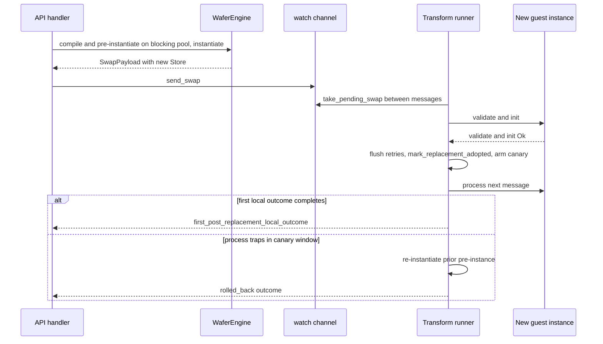

# Trace a stateless hot-swap

> **Read first:** [Cross the plugin boundary](plugin-boundary.md) and [Shutdown and failure behavior](shutdown-and-failure.md).

This walkthrough follows a hot-swap request from the HTTP handler to the runner that adopts the new plugin, and then the bounded rollback if the new version traps. By the end you will know where a replacement is compiled and instantiated, how it reaches the running node, why it is applied only between messages, what the API response does and does not prove, and what guest state is lost. It uses a Transform node, because only the Transform runner implements process-time rollback; Filter and Router support the same replacement up to that point.

## The path



1. During pipeline construction (`build_pipeline_inner` in `crates/wafer-core/src/orchestrator/builder.rs`), each Transform, Filter, and Router bundle receives `watch::channel(None)`. Sources and sinks receive no swap channel.
2. `POST /api/v1/nodes/{id}/hot-swap` reaches the `hot_swap` handler (`crates/wafer-core/src/api/handlers.rs`). It takes the per-node swap guard with `PipelineHandle::try_begin_swap` (`crates/wafer-core/src/orchestrator/pipeline.rs`), reads the replacement bytes, and selects the preparation function for the node category. For a Transform it calls `prepare_transform_swap_timed_with_fuel` (`crates/wafer-core/src/orchestrator/hotswap.rs`) with the node's effective fuel budget. That function compiles through the engine cache and pre-instantiates the typed world on Tokio's blocking pool (`compile_and_link`, which uses `spawn_blocking`), then creates a new Store and bindings and packages them in `SwapPayload::Transform` with `HotSwapProgress`.
3. `PipelineHandle::send_swap` publishes the payload through the node's watch sender. At the top of each iteration the transform runner calls `take_pending_swap` (`crates/wafer-core/src/runner/mod.rs`), which checks for an unseen version (through `swap_pending`, which calls `swap_rx.has_changed()`) before another message is selected, and its input wait also wakes on `swap_rx.changed()`, so an idle node swaps at once. Replacement happens between guest calls rather than by cancelling one. `take_pending_swap` also claims the payload with `HotSwapProgress::try_claim`. If the handler's 5 s wait for an outcome ends before that claim, the handler withdraws the payload with `try_withdraw` and answers 504, and the runner then ignores it. If the runner has already claimed it, the handler waits up to 30 s more for adoption or failure before answering.
4. `SwapPayload::try_apply_transform` takes ownership of the prepared Store and bindings. `WasmTransformNode::try_hot_swap` (`crates/wafer-core/src/node/wasm.rs`) rejects a replacement whose capabilities or inference grant differ from the running node, then swaps the new values in and initializes them, putting the old ones back if initialization fails:

   ```rust
   let old_store = std::mem::replace(&mut self.store, replacement.store);
   let old_bindings = std::mem::replace(&mut self.bindings, replacement.bindings);
   let old_pre = std::mem::replace(&mut self.cached_pre, replacement.pre);
   match self.validate_and_init(&config_json).await {
       Ok(()) => Ok(()),
       Err(err) => {
           self.store = old_store;
           self.bindings = old_bindings;
           self.cached_pre = old_pre;
           Err(err)
       }
   }
   ```
5. When that returns `Ok`, the runner (`run_transform_loop_with_config` in `crates/wafer-core/src/runner/transform.rs`) flushes pending retries to the DLQ with `DlqReason::HotSwapDrain`, calls `mark_replacement_adopted`, records a swap, and retains the prior `InstancePre` in a canary. A failed swap keeps the old instance and its retries. The canary closes after `engine.hot_swap.canary_success_count` successful calls (default 32) or `canary_window_ms` (default 10000 ms), whichever comes first (`HotSwapConfig` in `crates/wafer-types/src/config/engine.rs`); the runner checks this at the top of each iteration. The first forwarded/enqueued, filter-dropped, or router-dropped result completes `first_post_replacement_local_outcome`. A reconfigure uses the same watch channel and guard but never arms a canary.
6. If the new Transform traps while that canary is active (including an epoch or fuel trap), the runner restores the prior cached pre-instance and calls `transform.recover_from_cached_pre()`. This creates another fresh Store, re-instantiates prior code, runs lifecycle initialization, retries the trapped envelope, and records recovery and rollback metrics. The canary is consumed by the rollback, so each swap rolls back at most once; a later trap in the restored version takes the ordinary recovery path. It reports `rolled_back` only while the caller is waiting; a later rollback cannot rewrite an already completed local-outcome response.

## How the pieces are owned

[Tokio in context](tokio-in-context.md) covers the `watch`, `oneshot`, and `Notify` APIs used here. A Tokio watch channel stores the latest `Option<SwapPayload>`. The payload is cloneable because the single-consumer Store and binding values sit in `Arc<Mutex<Option<T>>>`; `Option::take` transfers each prepared value exactly once into the owning runner task.

The live node is not shared behind a hot-path mutex; the runner owns it, which is why the `std::mem::replace` transaction above needs no lock.

`HotSwapProgress` (`crates/wafer-core/src/runner/mod.rs`) combines `OnceLock` timestamps with a oneshot result, plus an `AtomicU8` whose compare-exchange lets exactly one side win: the runner's claim or the API's withdrawal. Adoption alone does not complete the response. The first runner-local outcome supplies the second marker. Before that marker consumes the sender, a process-time rollback completes the pending caller with `rolled_back`. After a successful local outcome has already returned, a later canary rollback cannot rewrite the response; recovery state and metrics are then the remaining local record.

## What "stateless" means

Hot-swap is stateless replacement. Mutable guest state is lost whenever a new Store and instance replace the old ones, and the replacement starts from its own `init`. The host never calls the outgoing guest's `close` export: the old Store is simply dropped, so a plugin cannot rely on `close` to flush or hand over state. The prior `InstancePre` retained for process-time rollback contains reusable compiled and linked code, not a snapshot of guest memory, globals, handles, or thread-local plugin state.

There are two different failure behaviors. Failed `validate` or `init` restores the still-retained old Store and bindings inside `try_hot_swap`. A later transform `process` trap invokes configured canary recovery by instantiating the prior pre-instance into a fresh Store. Neither path retains mutable state from the discarded guest instance.

The documented node-state tracker has Error, Recovering, and Running transitions during process-time recovery. There is no separate rollback node-state transition. Do not invent one from the `rolled_back` API status or rollback metric.

## Limits to keep in mind

- Every Transform, Filter, and Router bundle gets a watch channel, but only loaded Wasm nodes are marked replacement-eligible. A native Transform or Filter baseline rejects a Wasm swap.
- Only the Transform runner has process-time canary rollback. Do not generalize it to Filter or Router.
- The API response proves adoption and one runner-local outcome. It says nothing about sink transition, sequence continuity, loss, or throughput; those need evaluation artifacts.

## Check yourself

Locate the point where `take_pending_swap` checks `swap_rx.has_changed()`. List what a full replacement transfers, what survives only as reusable host-side code/configuration, and what mutable guest state disappears. Finally, explain why `rolled_back` is an API outcome rather than a new `NodeState` variant.

## Next

[From experiment definition to evidence](evaluation-harness.md) shows how hot-swap and the other behaviors were measured.
